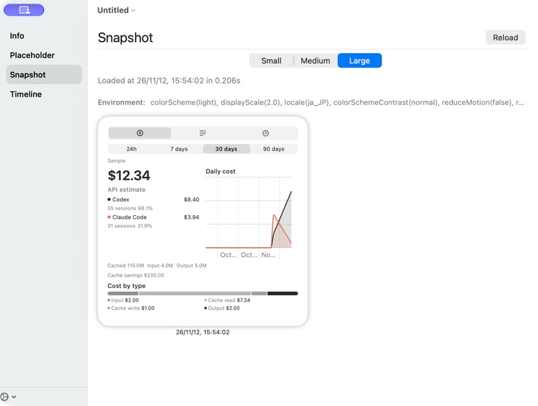
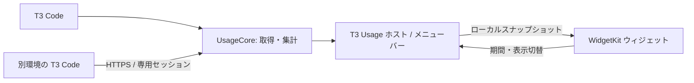

# T3 Usage

T3 Code のトークン、推定コスト、利用上限を macOS のデスクトップとメニューバーで確認する、独立したコンパニオンアプリです。



*WidgetKit Simulator のサンプル表示です。画像内の数値は実際の使用量ではありません。*

## 特徴

- **Cost / Tokens / Limits**：プロバイダー別の内訳、使用量の推移、利用上限を表示。
- **デスクトップウィジェット**：小・中・大サイズに対応し、ウィジェット内で表示と期間を切替。
- **メニューバー**：アプリのウィンドウを閉じても使用量を確認・更新。
- **期間**：過去24時間、7日、30日、90日。
- **複数環境**：HTTPS と専用のペアリングで別の T3 Code 環境を追加し、使用元の重複を考慮して集計。
- **言語**：日本語、English、简体中文、繁體中文。システム設定への追従と手動選択に対応。

コストは API 価格に基づく**推定額**です。価格未設定の使用量は推定額に含まれず、画面にその旨を表示します。取得できない環境や不完全なデータは、ゼロではなく部分取得として扱います。

## 必要環境

- macOS 14 以降
- 起動中の [T3 Code](https://github.com/pingdotgg/t3code) と、この Mac で利用可能な `t3` コマンド
- ビルドには Xcode、Swift、[XcodeGen](https://github.com/yonaskolb/XcodeGen)

T3 Usage と T3 Code の両方が起動している間にデータを更新します。ウィジェットの更新時刻は macOS により調整されるため、リアルタイムとは限りません。

## ビルドと起動

リポジトリのルートで実行します。

```bash
make check          # 書式・ビルド・テスト
make app            # ローカル実行用のアドホック署名済みアプリを作成
make install-local  # 既存のアプリを退避し ~/Applications に配置
```

`make install-local` の実行前に T3 Usage を終了してください。アプリを起動したら、デスクトップを右クリックして「ウィジェットを編集」を選び、**T3 Usage** を追加します。メニューバーのグラフアイコンからも使用量を確認できます。

現時点ではソースからのローカルビルドを前提としており、署名・公証された配布版は用意していません。

## 別の T3 Code 環境を接続

1. 接続先の T3 Code で HTTPS 接続先と環境 ID を確認します。
2. 接続先で一回限りのペアリングコードを発行します。必要な権限は `diagnostics:read` と `orchestration:read` です。
3. T3 Usage のホスト画面で **Remote environment** を開き、HTTPS URL、環境 ID、コードを入力して接続します。

接続先の環境 ID は認証情報の送信前に確認します。専用セッションのトークンは macOS Keychain に保存し、ウィジェットには渡しません。同画面から接続を解除できます。

## 仕組みとプライバシー



ホストはウィジェットとの連携に `127.0.0.1:47831` を使います。ネットワーク上の別マシンからは接続できませんが、**同じ Mac の他のユーザーやプロセスが使用量を読み、表示タブ・期間を変更できる可能性があります**。資格情報、会話内容、ファイルパスはスナップショットに含めません。ホストが停止すると公開を終了し、古いデータは期限切れとして扱います。

ローカル T3 には短命の読み取りセッションを使います。別環境には独立した認証を使用し、T3 Code アプリの保存済み資格情報を流用しません。

## 開発

| パス | 内容 |
| --- | --- |
| `Sources/UsageCore` | T3 への接続、集計、言語、スナップショット |
| `Sources/UsageWidget` | ウィジェットの画面、グラフ、切替操作 |
| `App` | SwiftUI ホスト、メニューバー、ローカル通信 |
| `WidgetExtension` | WidgetKit のエントリポイント |
| `Tests` | 集計、欠損値、接続設定などのテスト |

`swift run UsageProbe --bridge` でホストからの取得状態を確認できます。進捗と未検証の項目は [PLANS.md](PLANS.md)、検証観点は [docs/test-list.md](docs/test-list.md) を参照してください。
