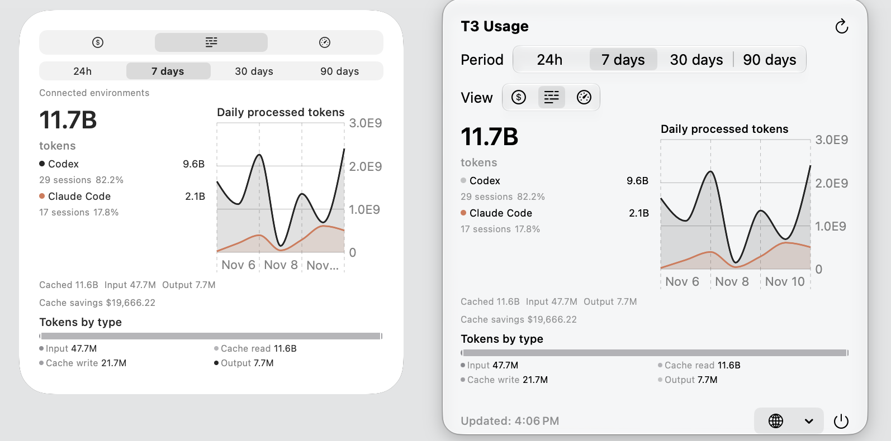

# T3 Usage

> T3 Code のトークン、コスト、利用上限を macOS で確認するコンパニオンアプリ。

<p align="center">
  <a href="docs/images/overview.png"></a>
</p>

## はじめ方

macOS 14 以降、起動中の [T3 Code](https://github.com/pingdotgg/t3code)、`t3` コマンド、Xcode、Swift、[XcodeGen](https://github.com/yonaskolb/XcodeGen) が必要です。

```bash
git clone https://github.com/ackkerman/t3-usage-widget.git
cd t3-usage-widget
make app
make install-local
open "$HOME/Applications/T3 Usage.app"
```

更新する場合は T3 Usage を終了してから `make install-local` を実行してください。

デスクトップを右クリックし、「ウィジェットを編集」から **T3 Usage** を追加します。メニューバーのアイコンからも確認できます。

## 機能

- Cost・Tokens・Limits の表示と期間切替
- 小・中・大のデスクトップウィジェットとメニューバー表示
- 別の T3 Code 環境の使用量を統合
- 日本語・英語・中国語（簡体字／繁体字）に対応

別環境の接続方法、プライバシー、開発については [ガイド](docs/guide.md) を参照してください。
